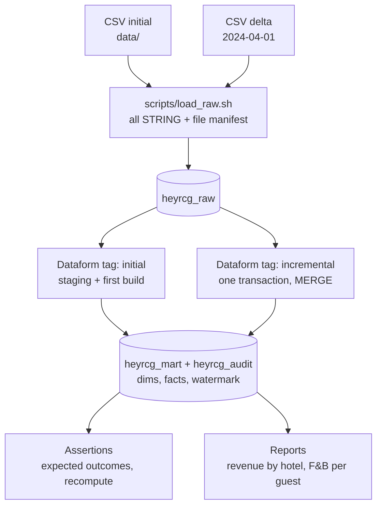

# HeyRCG take-home: incremental Kimball mart on BigQuery + Dataform

Raw bookings, customers and POS data are cleaned, modelled into a star schema, and kept up to date
from daily delta files without rebuilding (watermark + MERGE + SCD Type 2, in one transaction).

## Architecture

| Layer | Dataset | Contents |
|---|---|---|
| Raw | `heyrcg_raw` | CSV rows as received + `file_manifest` |
| Staging | `heyrcg_stg` | `stg_*` cleaned views, `ref_*` mapping tables, `stg_quarantine` |
| Mart | `heyrcg_mart` | `dim_date`, `dim_hotel`, `dim_customer` (SCD2), `fact_bookings`, `fact_pos_transactions`, `rpt_*` |
| Audit | `heyrcg_audit` | `etl_watermark`, `customer_change_log`, `etl_run_log` |
